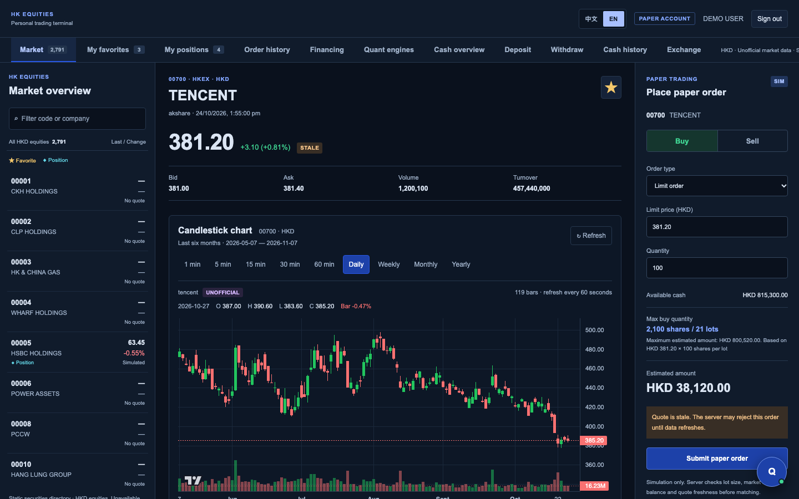

# Personal Hong Kong Trading Terminal

A dark-theme personal Hong Kong equities workspace built with React, Go, MySQL, and Docker Compose. It combines a market directory, candlestick chart, favorites, paper orders, positions, cash tools, notes, and an AI assistant in one desktop-style interface.

> This repository is a simulated-trading prototype. It does not connect to a broker, send real orders, or provide an official HKEX market-data feed.



## Report editions

- [Portfolio overview](docs/interview/README.md) — short, screenshot-led introduction for reviewers.
- [Product walkthrough](docs/interview/README-product.md) — page flow, features, and interaction design.
- [Engineering notes](docs/interview/README-engineering.md) — architecture, data boundaries, security, testing, and deployment.
- [Printable HTML notes](docs/interview/personal-trading-terminal-notes.html)
- [PDF report](docs/interview/personal-trading-terminal-report.pdf)

## Demo account

- Email: `021021hxc@gmail.com`
- Username: `021021hxc`
- Password: provisioned in the local demo database and shared separately
- Favorites: Tencent (`00700`), Alibaba (`09988`), Xiaomi (`01810`)

The account is for local demonstration only. Passwords are not committed to Git.

## Run locally

```sh
docker compose up -d
```

- Frontend: <http://localhost:3000>
- Backend health: <http://localhost:8080/health>
- phpMyAdmin (optional profile): <http://localhost:8081>
- MySQL: `localhost:3306`

To start the optional database administration service:

```sh
docker compose --profile admin up -d
```

The backend applies database migrations at startup. Development fallback credentials are present for local use; set your own database passwords and webhook secret before exposing any service.

## Stack

| Layer | Technology | Responsibility |
| --- | --- | --- |
| Frontend | React + TypeScript | Desktop trading workspace and interaction states |
| Backend | Go | Authentication, market adapters, portfolio and order services |
| Database | MySQL | Users, sessions, favorites, paper orders, positions and balances |
| Market collector | Python / AkShare adapter | Unofficial prototype quotes and historical bars |
| Deployment | Docker Compose | Local service orchestration |

## Checks

```sh
cd apps/backend
go test ./... -count=1
go vet ./...
```

```sh
cd apps/frontend
npm ci
npm run test:frontend
npm run build
```

```sh
python3 -m unittest discover -s services/akshare/tests -p 'test_*.py'
openspec validate ux-securities-hkex-trading-terminal --strict
```

## Documentation

- [Product requirements](docs/PRD.md)
- [API contract](docs/api/openapi.yaml)
- [Workbench design](docs/design/workbench-layout.md)
- [Candlestick history contract](docs/design/candlestick-history.md)
- [Evidence index](docs/evidence/README.md)

Market data in this prototype is unofficial and may be delayed, stale, incomplete, or unavailable. The chart uses [TradingView Lightweight Charts](https://github.com/tradingview/lightweight-charts); notices are stored in `apps/frontend/public/third-party-notices.txt`.
