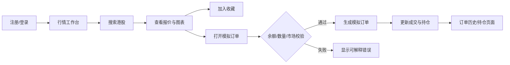

# UX Securities 港股交易终端 PRD

**版本**：0.1（规划稿）  
**日期**：2026-10-24  
**产品品牌**：UX Securities Limited  
**文档状态**：待评审，尚未授权实施代码

## 1. 产品概述

UX Securities 是一个面向个人用户的港股行情与模拟交易终端。用户可以创建自己的账号，查看 HKEX 港股行情，把股票加入收藏，提交模拟买卖订单，并查看模拟持仓和订单历史。

用户提供的 Futubull 截图用于参考交易终端的布局关系：左侧导航和标的列表，中间为行情/图表主区，顶部为搜索、市场和品种切换，底部可呈现市场状态。截图中的美股标的、Futubull 品牌、会员文案和具体数值不属于本产品需求。

用户提供的 `UX Securities Limited` Logo 是本产品唯一指定品牌标识，界面规范、素材和业务文案均以本项目自身设计为准。

## 2. 目标与非目标

### 2.1 目标

1. 提供可登录、可隔离的个人账户空间。
2. 接入可合法使用的 HKEX 行情数据，并在行情不可用或延迟时清楚标识状态。
3. 让用户搜索港股、查看报价和图表、加入/移除收藏。
4. 让用户使用模拟资金提交买卖订单，并形成可追溯的订单、成交和持仓记录。
5. 用 Go + React + MySQL + Docker Compose 形成可本地运行的单体式产品基线。

### 2.2 非目标

- 第一版不直接连接 HKEX 交易撮合系统。
- 第一版不发送真实订单，不处理真实开户、入金、出金或资金托管。
- 不通过抓取 HKEX 网页实现生产行情接入。
- 不实现融资融券、期权行权、自动交易策略、社交跟单、推荐或投顾结论。
- 不把 Futubull 截图中的第三方品牌、股票和文案复制到产品。

## 3. 用户与权限

### 3.1 普通用户

- 注册、登录、退出和修改个人资料。
- 查看行情、收藏标的、提交和取消自己的模拟订单。
- 查看自己的现金余额、持仓、成交和订单历史。

### 3.2 系统服务账号

行情同步服务使用服务凭据访问已授权的数据源；不属于可登录的用户，也不能读取用户密码。管理员后台不在第一版范围内，数据库运维可用本地 phpMyAdmin 完成。

## 4. 核心用户流程



## 5. 页面与交互需求

### 5.1 登录与注册

- 邮箱或用户名、密码、确认密码字段。
- 密码使用强哈希保存；登录成功后创建受保护的 session/token。
- 登录失败不得暴露账号是否存在；前端显示可理解的错误。
- 未登录访问行情工作台、收藏、订单和持仓时跳转登录。

### 5.2 行情工作台

- 左侧：市场筛选、搜索、收藏/标的列表。
- 中间：当前标的名称、代码、最新价、涨跌额、涨跌幅、成交量、成交额、交易状态和时间戳。
- 主图：第一版至少支持日线 OHLCV；数据不足时显示空态和来源状态。
- 右侧或详情抽屉：买入/卖出模拟订单入口、收藏切换、标的基本信息。
- 页面必须区分 `live`、`delayed`、`stale`、`unavailable` 行情状态，不得让用户把过期数据误认为实时价格。
- 桌面端参考截图的高密度工作台；窄屏改为单列或抽屉，不能产生横向溢出。

### 5.3 收藏

- 用户可以添加、移除和排序自己的收藏标的。
- 收藏列表显示代码、名称、最新价、涨跌幅和行情状态。
- 重复添加必须幂等；不存在的标的和已退市标的显示明确错误或状态。

### 5.4 模拟订单

- 支持买入/卖出、限价单；市价单是否开放由行情供应商和撮合规则评审后决定。
- 输入：标的、方向、数量、价格（限价单）、有效期说明和确认动作。
- 港股数量必须遵守产品配置的交易单位/手数规则；规则不能写死在前端。
- 提交前展示估算金额、可用余额、费用占位和行情时间戳。
- 订单状态：`pending`、`filled`、`cancelled`、`rejected`。
- MVP 模拟撮合使用服务端价格和规则；前端不得自行修改成交状态或持仓。
- 下单成功后刷新余额、持仓、成交和订单历史；重复提交需用幂等键避免重复订单。

### 5.5 持仓与订单历史

- 持仓页显示代码、名称、数量、可用数量、平均成本、现价、未实现盈亏和估值。
- 订单历史支持按标的、方向、状态和时间筛选，显示创建时间、成交时间、数量、价格、状态和拒绝原因。
- 用户只能看到自己的数据；查询接口必须在服务端按用户身份过滤。

## 6. HKEX 行情接入方案

### 6.1 官方事实

HKEX 官方实时数据页面将行情分为证券市场 OMD-C、衍生品市场 OMD-D 和发行人消息 IIS。OMD-C 提供 SS、SP、SF 等不同深度；OMD-D 提供 DS、DP、DF 等不同深度。HKEX 同时提供 OMD 协议、开发者指南、连接指南以及市场数据许可说明。

官方资料：

- [Real-time Datafeeds](https://www.hkex.com.hk/Services/Market-Data-Services/Real-Time-Data-Services/Overview/Real_time-Datafeeds?sc_lang=en)
- [OMD-C Securities Market](https://www.hkex.com.hk/Services/Market-Data-Services/Infrastructure/HKEX-Orion-Market-Data-Platform-Securities-Market-OMD-C?sc_lang=en)
- [OMD-D Derivatives Market](https://www.hkex.com.hk/Services/Market-Data-Services/Infrastructure/HKEX-Orion-Market-Data-Platform-Derivatives-Market-OMD-D?sc_lang=en)
- [HKEX Data Marketplace](https://www.hkex.com.hk/Services/Market-Data-Services/Historical-Data-Services/HKEX-Data-Marketplace?sc_lang=en)

### 6.2 产品决策

- 第一阶段只规划港股证券行情，使用 OMD-C 或已授权的信息供应商适配器。
- 首个可用层级优先选择 Level 1/OMD-C SS；只有产品明确需要十档盘口或逐笔委托时才引入 SP/SF。
- 衍生品 OMD-D 留作后续能力，不能在第一版 UI 中伪装已经接入。
- 历史数据使用 HKEX Data Marketplace 或授权供应商，用于回测、图表和测试数据。
- MVP 开发和模拟场景选用 AkShare 作为港股历史日线 K 线的可选采集/导入工具；数据写入 MySQL 后由 Go 后端提供。AkShare 是 Python 开源库及非官方数据适配，不是 HKEX 授权实时 feed；不得将其直接嵌入 Go 业务层或据此标记 `live`。实际使用前需核对上游可用性、许可/条款与字段变化。
- 供应商未确认前，系统提供 `MockMarketDataProvider`，用于开发和自动化测试；生产配置必须显式选择授权 provider。

### 6.3 行情适配器边界

后端定义统一的内部行情模型，例如 `symbol`、`display_name`、`last_price`、`bid`、`ask`、`change`、`change_percent`、`volume`、`turnover`、`as_of`、`market_status`、`data_status`。HKEX OMD 二进制报文或供应商字段只在 adapter 层解析，不泄漏到前端和订单领域。

行情同步断线、心跳超时、序列缺口、供应商拒绝、字段缺失和恢复必须记录脱敏日志，并把数据状态更新为 `stale` 或 `unavailable`。模拟撮合不得使用超过允许时限的过期价格。

AkShare 仅用于本地开发/模拟场景的历史日线采集与导入，不作为运行时实时行情 provider。导入数据需保留来源和采集时间供审计；K 线 API 与界面应标明 `AkShare` / `unofficial`，且不得用于真实交易。

### 6.4 免费与收费边界

| 方案 | 成本判断 | 可否作为本产品正式行情源 | 说明 |
|---|---|---|---|
| `MockMarketDataProvider` | 免费 | 仅开发、演示和自动化测试 | 不代表真实市场数据，必须在界面标注模拟来源。 |
| AkShare 港股历史日线 | 开源工具；上游数据可用性及条款需核对 | 仅开发、模拟与历史图表导入 | 由本地 Python 工具采集并导入 MySQL；标注 `unofficial`，不代表 HKEX 官方实时行情，不用于真实交易。 |
| HKEX 官网公开报价页面 | 可免费浏览 | 否，不能当作通用 API | 适合人工查看；不得用网页抓取冒充正式行情接口，且公开页面的延迟、字段和使用条款需要单独确认。 |
| 第三方免费层或延迟 API | 可能免费 | 仅在确认覆盖、配额和许可后 | 必须标注 `delayed`，确认可覆盖港股代码，并把供应商条款记录在行情适配器文档中。 |
| HKEX OMD-C/OMD-D 或授权供应商实时 feed | 通常需要许可和费用 | 是 | 生产实时行情的目标方案；先完成授权、费用、连接和数据再分发确认。 |
| HKEX Data Marketplace 历史数据 | 依产品和授权而定 | 适合历史图表、回测和测试 | 不能默认视为免费；采购前确认数据集、价格、下载方式和再使用范围。 |

因此，MVP 的零成本路径是 `MockMarketDataProvider`；开发者可用 AkShare 导入历史日线用于图表演示，但需核对上游条款，并明确标识非官方来源。若需要运行时真实但非实时的报价，再增加经过条款确认的延迟数据适配器。只要面向生产用户提供实时 HKEX 行情，就按授权数据预算规划，不把“免费网页报价”写成 API 能力。

## 7. 技术架构与部署

### 7.1 单体式边界

单体式指一个 Go 后端部署单元承载认证、行情、收藏、模拟撮合、订单和持仓业务；不拆微服务。React 前端作为独立静态资源容器构建，MySQL 为持久化依赖。

```text
Browser
  ├─ frontend:3000  (React)
  └─ backend:8080   (Go MVC API)
       └─ mysql:3306
       └─ market-data adapter (HKEX/provider)

phpMyAdmin:8081  (local/admin profile only)
```

### 7.2 建议项目档案

```text
docs/
├─ PRD.md
├─ design/
│  ├─ design.md
│  ├─ develop-frontend-design.md
│  ├─ develop-backend-design.md
│  ├─ develop-design-task-linkage.md
│  └─ project-archive.md
├─ api/openapi.yaml
├─ api/hkex-market-data.md
└─ evidence/{README.md,screenshots/,reports/}
apps/frontend/
apps/backend/
deploy/docker-compose.yml
db/migrations/
```

`design.md` 必须记录每个计划目录和文件的状态（复用、修改、计划新增或移除）、职责、接口和验证证据。前端设计和后端设计分开维护，任务清单按 FE/BE/DB 编号追溯，数据库阶段先于依赖它的应用阶段。

### 7.3 分层约束

- Go：`controller/handler → service/usecase → domain/model → repository → provider/integration`。
- React：页面路由、页面容器、功能组件、API client、查询/会话状态和共享 UI 分开。
- MVC 是产品架构约束；不允许在 controller 直接拼接复杂 SQL，不允许在 React 组件内复制认证、订单或行情业务规则。
- 每个代码文件不超过 500 行；超过时拆成可独立测试的模块，并在设计档案说明拆分原因。

## 8. 数据模型草案（MVP 传统宽表）

MVP 使用 8 张传统宽表，便于实现和通过 phpMyAdmin 查看：`users`、`sessions`、`stocks`、`stock_daily_quotes`、`watchlists`、`accounts`、`orders`、`positions`。`stocks` 保存最新报价，`stock_daily_quotes` 保存日线，`orders` 直接保存成交数量、成交价和成交时间，不新增 `executions` 或 `position_lots`。

只做必要 hash：密码保存强哈希，session token 保存 SHA-256 hash；用户名、邮箱、股票代码、订单号、幂等键等业务字段保持明文可查询。关键不变量：用户隔离、订单状态可追溯、成交与持仓更新原子化、重复请求不重复下单、订单不能使用另一个用户的账户余额。

## 9. 内部 API 草案

最终合同写入 `docs/api/openapi.yaml`。至少需要：

- `POST /api/v1/auth/register`
- `POST /api/v1/auth/login`
- `POST /api/v1/auth/logout`
- `GET /api/v1/me`
- `GET /api/v1/markets/symbols?query=`
- `GET /api/v1/markets/quotes/{symbol}`
- `GET /api/v1/markets/candles/{symbol}`
- `GET /api/v1/watchlist`
- `POST /api/v1/watchlist`
- `DELETE /api/v1/watchlist/{symbol}`
- `GET /api/v1/orders`
- `POST /api/v1/orders`
- `POST /api/v1/orders/{id}/cancel`
- `GET /api/v1/positions`
- `GET /api/v1/account`

错误响应需包含稳定的 `code`、用户可显示的 `message`、可选 `details` 和 `request_id`；不得把 SQL、供应商密钥或堆栈返回给前端。

## 10. 验收标准

### MVP 必须通过

- 新用户能注册、登录和退出；用户 A 无法读取用户 B 的收藏、订单和持仓。
- 行情页能搜索至少一组港股测试标的，明确显示数据时间和 `live/delayed/stale/unavailable` 状态。
- 用户能添加、移除和重复幂等地维护收藏。
- 用户能通过服务端校验提交模拟限价买卖单；失败时不改变余额、持仓或订单状态。
- 模拟成交后，账户余额、持仓和订单历史在一次一致性事务中更新。
- Docker 冷启动后前端、后端、MySQL 可用；phpMyAdmin 能查看迁移后的表和数据。
- 所有生产代码文件小于 500 行；敏感信息不进入仓库、前端构建产物或日志。

### 行情接入门禁

- 若尚未取得 HKEX 或供应商许可，必须使用 mock provider 或历史数据，不得声称“已接入实时 HKEX”。
- 若未来接入真实券商，必须新增供应商合同、交易接口文档、订单状态映射、风控和人工确认门禁；在此之前保持模拟交易模式。

## 11. MVP 实施默认与上线前待确认事项

为避免开发期间暗中写死未决业务，本 change 采用以下可追溯默认；这些默认不等于生产许可或商业确认：

1. 注册同时使用用户名和邮箱，登录可使用任一身份；MVP 不做邮箱/手机验证。
2. 初始模拟资金默认 HKD 1,000,000，可由服务端环境配置覆盖；交易单位读取证券的 `lot_size`。手续费默认 0 bps、撮合延迟默认 0 秒，Phase 3 必须由服务端配置并在界面标明估算/模拟属性。
3. MVP 报价/搜索默认只建模 mock fixture 中的 HKEX 普通股票；日线 OHLCV 允许使用 AkShare 本地导入的历史数据。ETF、REIT、窝轮、牛熊证、衍生品、分钟线和更高频数据不在当前实现范围。
4. 未取得许可前默认 `MockMarketDataProvider`；数据库缓存或免费公开源只能作为非授权来源并标记 `unofficial/delayed/stale/unavailable`。OMD-C 或授权供应商必须在未来完成合同、adapter 与许可审查后显式启用。
5. 桌面高密度布局和 390px 窄屏适配属于本次验收；多语言仍是后续范围。

上线前仍需产品/合规确认最终手续费、撮合时序、证券范围、数据供应商、许可、邮箱验证与多语言策略；未确认前保持模拟交易且不得标记实时授权行情。
