# 個人港股模擬交易終端 - 完整項目報告

> 項目框架與產品判斷 · 暗色實機截圖 · 更新日期 2026-11-07

項目框架為 React 前端、Go MVC 後端、MySQL 與 Docker Compose。產品定位是個人港股研究與模擬交易終端原型，圍繞「行情查看 → 多角度研究 → 決策工作流 → 賬戶覆盤」組織頁面。

- [HTML 網頁版](personal-trading-terminal-notes.html)
- [PDF 完整版](personal-trading-terminal-report.pdf)
- [產品流程版](README-product.md)
- [工程技術版](README-engineering.md)

## 工作台頁面

以下每一張截圖對應一個獨立導航頁，按頁面順序逐張展示。除了行情接入、賬號登錄密碼加密和代碼框架，其他業務視圖主要表達產品原型、頁面用途和目標交互。

### 01 · 市場與日 K

個人交易終端暗色工作台：左欄用於瀏覽和篩選證券；中欄呈現所選證券報價、漲跌幅與日 K；右欄放置訂單輸入原型，展示買賣方向、委託類型、價格、數量和購買力提示。

`證券目錄／篩選 → 報價／日 K → 模擬下單`

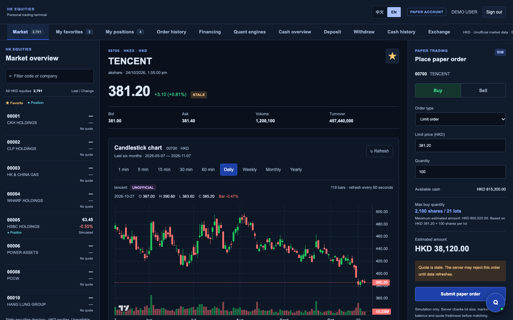

### 02 · 我的收藏

主列表集中展示已關注證券，列表標記用於識別自選項和持倉關聯；右側詳情區域承接所選證券信息，便於快速回到行情研究。收藏頁只保留 `00700`、`09988` 和 `01810`，不是市場目錄的重複頁面。

`收藏列表／持倉標記 → 證券詳情 → 行情研究`

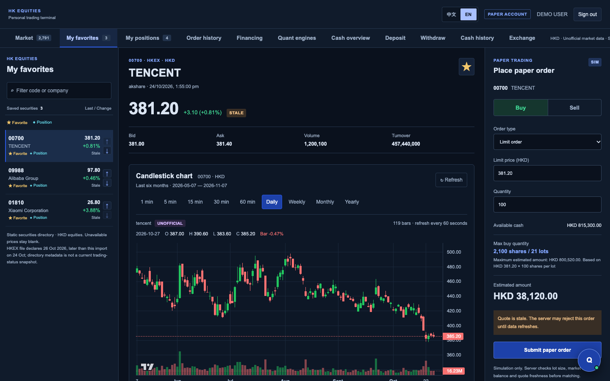

### 03 · 我的持倉

頂部彙總賬戶與組合概況；中部持倉表用於比較證券、數量和盈虧；組合分佈圖展示資產權重。這張截圖只保留持倉概覽，日、月、年盈利視圖分別展示，避免重複。

`資金概覽 → 持倉表／盈虧 → 資產配置`

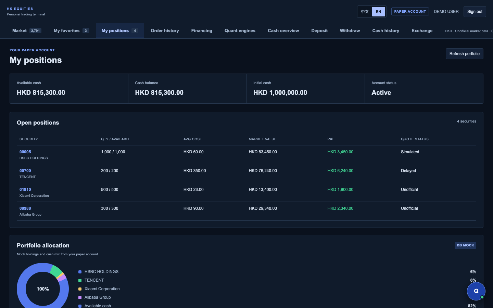

### 03A · 日盈利

持倉頁的盈利週期導航選擇「日」，下方以日曆單元格顯示每日已實現盈虧和收益率。

`日曆導航 → 每日已實現盈虧 → 收益率／明細`

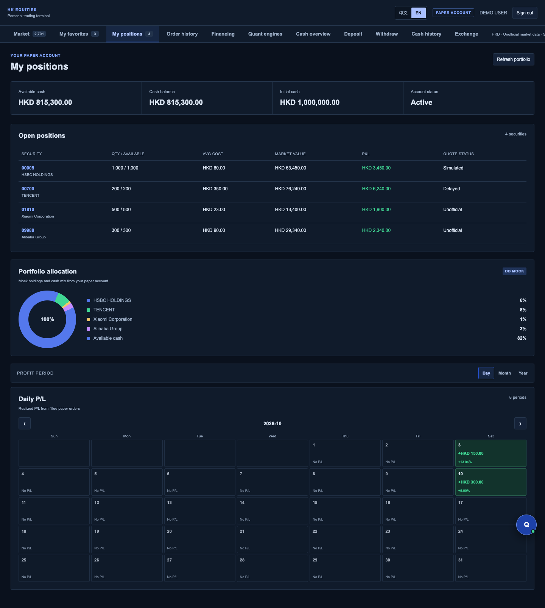

### 03B · 月盈利

切換「月」後按月份彙總已實現盈虧、收益率和無交易月份。

`月份導航 → 月度盈虧彙總 → 收益率／交易月份`

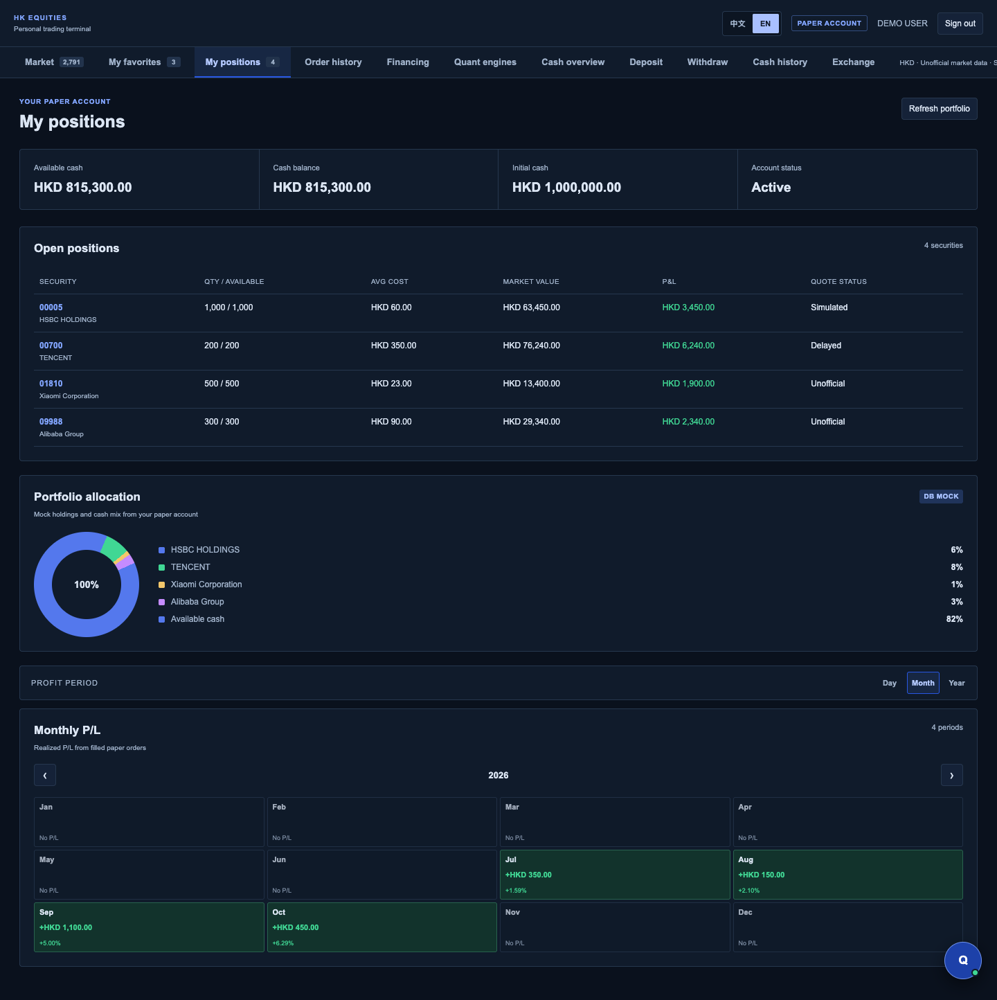

### 03C · 年盈利

切換「年」後顯示年度彙總卡片，保留年度盈虧金額與收益率。

`年度導航 → 年度盈虧卡片 → 收益率／回撤`

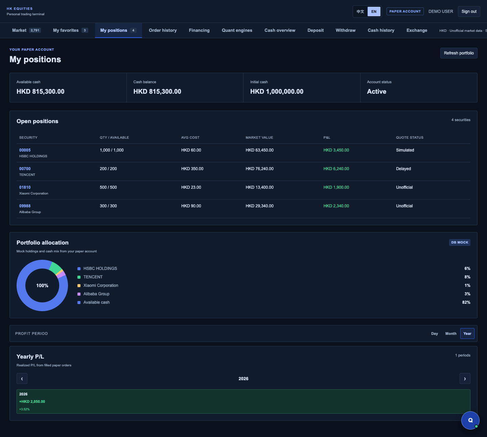

### 04 · 訂單歷史

頁頭承載訂單歷史標題和週期／狀態導航；下方表格用於逐筆查看證券、方向、委託數量、成交、價格、時間與狀態，便於追溯訂單生命週期。

`條件篩選 → 訂單明細表 → 狀態／生命週期`

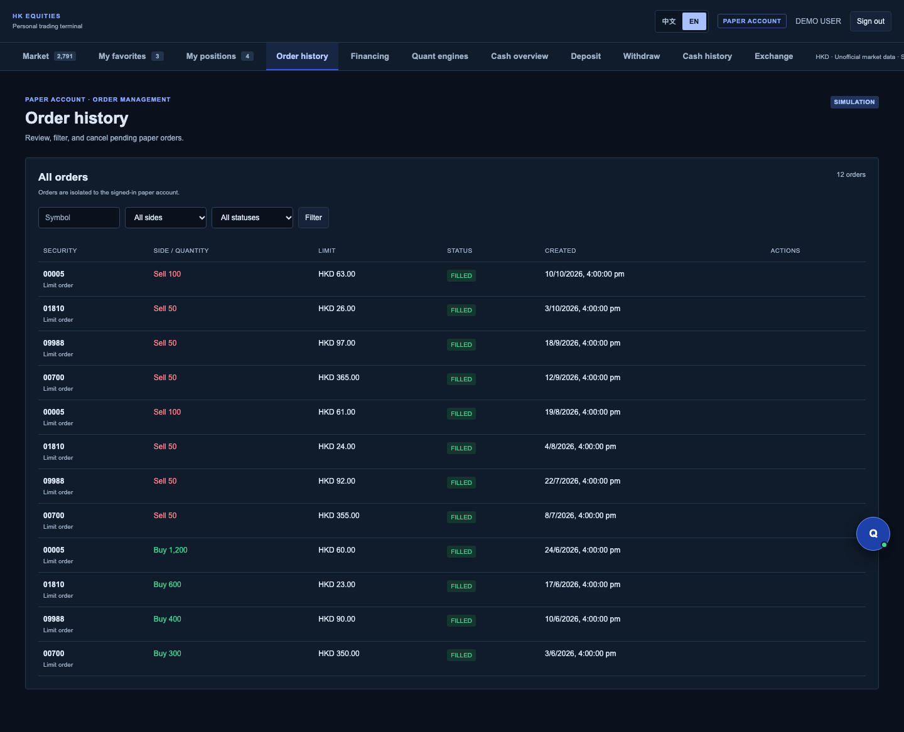

### 05 · 融資原型

頂部說明融資方案定位；左側區域輸入融資金額和相關參數；中部展示費用與額度估算；下方適格證券與風險監視區用於解釋擔保品、風險閾值和潛在風險。

`融資輸入 → 額度／費用估算 → 擔保品／風險監測`

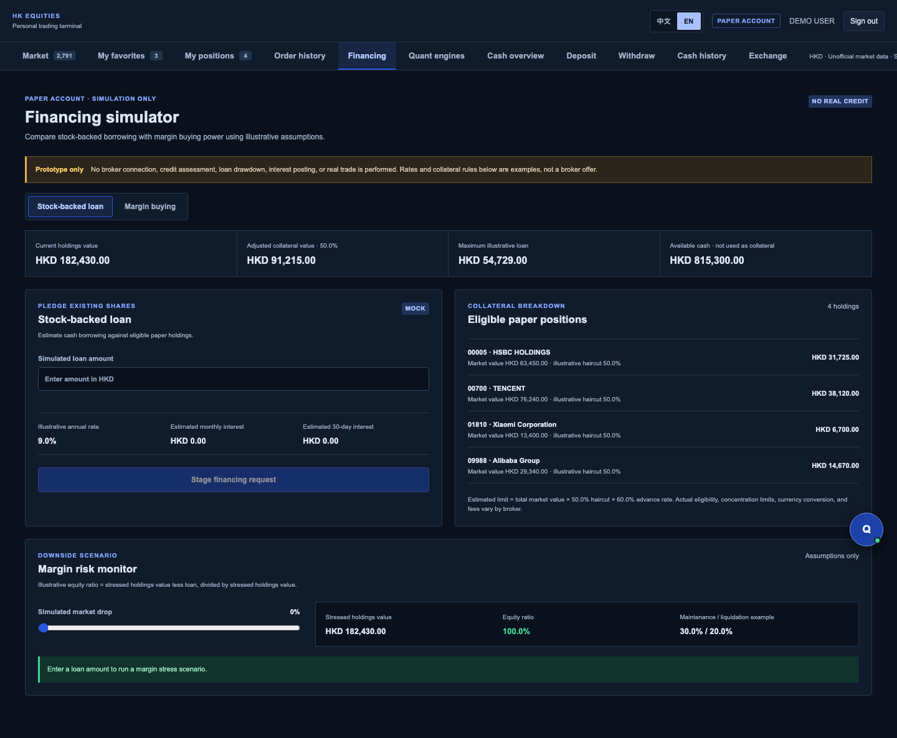

### 06 · 資金總覽

頁頭展示賬戶資金概況；賬戶快照列出總資產與可用金額；近期活動提供流水入口；多幣種餘額和圓環圖幫助比較 HKD、USD、CNY 的餘額結構。

`可用資金／現金 → 多幣種餘額 → 資產配置圓環圖`

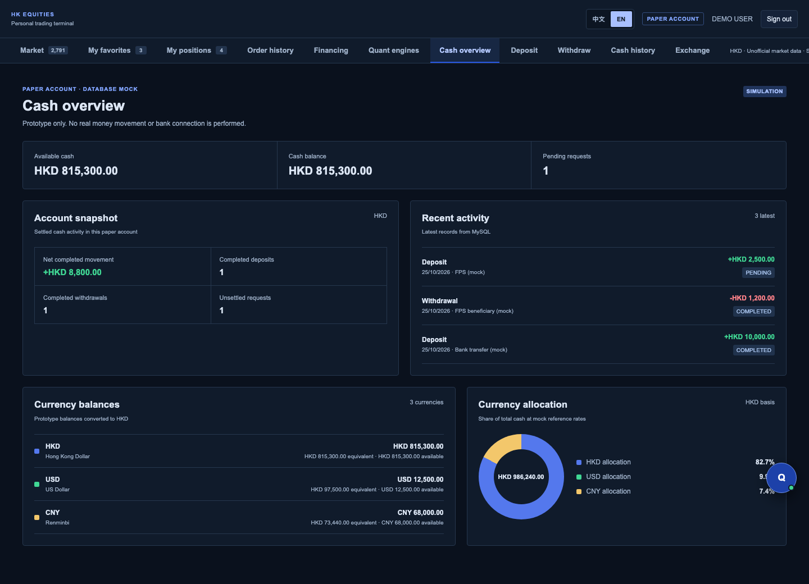

### 07 · 入金

左側表單選擇幣種、入金渠道並填寫金額；右側信息區解釋處理狀態與賬戶可入額度，呈現提交前的用戶預期。

`金額／入金方式 → 模擬申請 → 可入金額度／狀態`

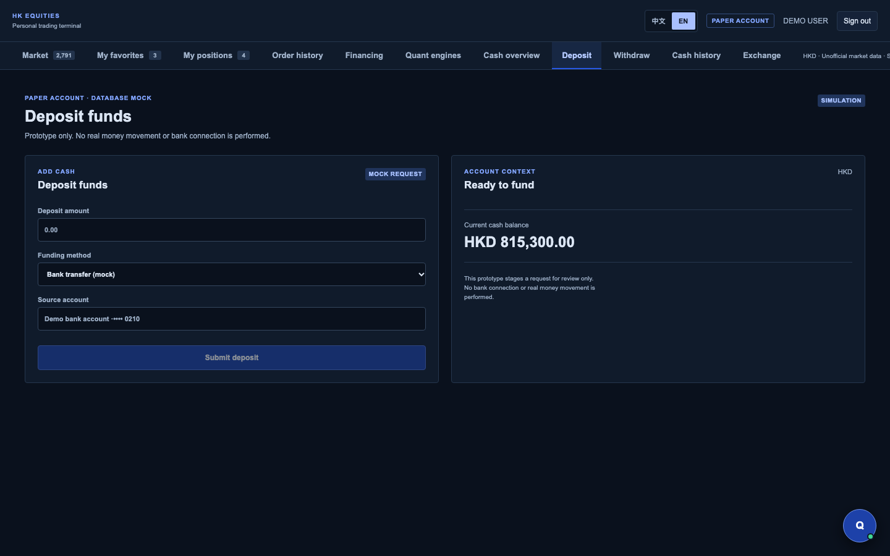

### 08 · 出金

主表單選擇幣種、出金方式和金額；餘額提示幫助檢查可提額度；提交區用於呈現確認前摘要和後續審核狀態。

`金額／出金方式 → 可提餘額校驗 → 確認／審核狀態`

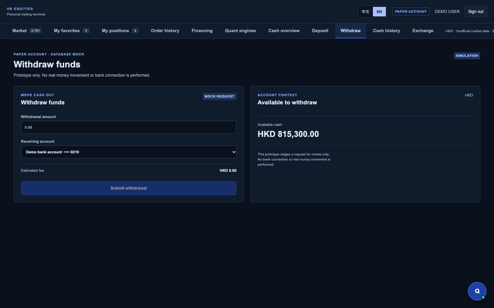

### 09 · 資金歷史

頂部時間／月份導航用於切換查詢區間；彙總區對所選區間分類統計；明細表按時間展示資金變動原因、幣種、金額和狀態，與資金總覽的餘額快照區分。

`時間／月份導航 → 分類彙總 → 流水明細／狀態`

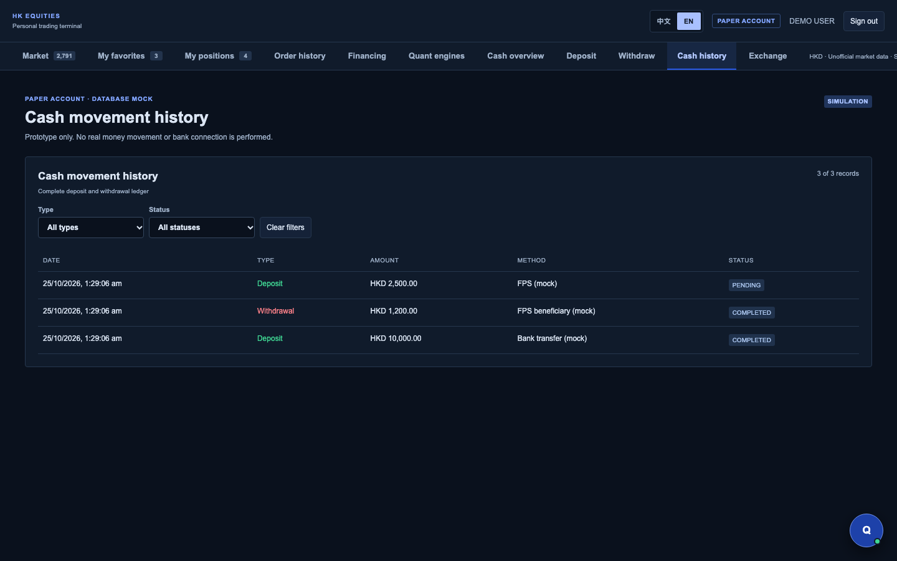

### 10 · 貨幣兌換

上方轉換表單選擇來源幣種、目標幣種並輸入金額；中間展示參考匯率、預計到賬和費用；下方匯率區對比 HKD、USD、CNY，幫助用戶理解兌換結果。

`來源幣種／金額 → 匯率／費用 → 目標幣種／預計到賬`

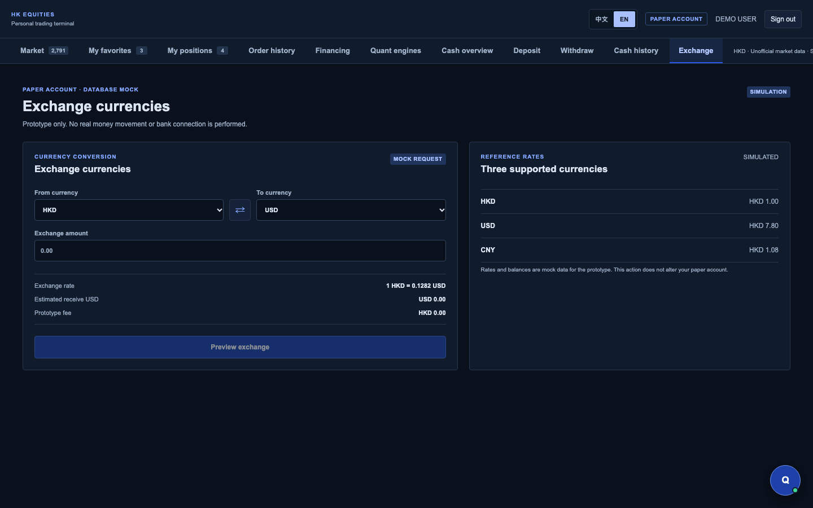

## Duo Agent Chatbot：Harness 與產品定位

行業產品形態正從「單輪問答」走向由 Harness 驅動的 Agent 工作流。Harness 是模型外圍的工程系統，負責多意圖辨識、任務路由、短期對話上下文與經用戶確認的長期記憶、工具權限、角色 Skill、結構化輸出、風險護欄、評測和運行軌跡。

本項目的量化助手提供多輪對話與記憶管理的交互原型；真實模型推理和多 Agent 服務尚未實現。

### 市場調研摘要：近一年升溫的 Harness Agent

近一年，Codex、Claude Code 等可執行開發 Agent，以及 DeepSeek 的開放權重路線，讓市場討論從「模型回答得好不好」擴展到「模型能否在受控工作流中完成任務」。公開一手資料可核對 2025–2026 年相關產品、框架和模型密集發布與演進，但不足以證明「今年才開始流行」或推導市場普及率。

這些產品與模型不是同一類東西，但共同指向 Harness：由工程層管理上下文、工具權限、任務路由、檢查點、評測和運行軌跡。以下是市場調研得到的產品機會，不表示本項目已接入 Codex、Claude Code 或 DeepSeek 推理服務。

`Codex／Claude Code：可執行 Agent 工作流 → Harness：路由／工具／評測／軌跡 → 金融：行情／持倉／風險 Skill`

1. **市場共識：** Agent 的競爭不只在模型參數，而在上下文準備、工具調用、權限隔離、結果驗證和失敗後恢復；這正是金融產品需要的可解釋流程。
2. **金融化方向：** 把行情 provider、日 K、持倉、訂單歷史、宏觀事件和回撤計算封裝成受限工具，由宏觀、產業、市場、量化和風險角色分工，再輸出證據、分歧和風險邊界。
3. **DeepSeek 路線：** 開放權重讓團隊可以評估自建或混合推理，降低對按 Token 計費 API 的單一依賴；但模型許可、基座條款、GPU、延遲、評測和資料留存仍需逐項核查。
4. **產品差異化：** 競品已有完整交易工具，本產品以「好上手」切入，把左側佈局、宏觀判斷和量化策略轉成分步學習路徑，讓用戶知道每個結論用了哪些數據、假設和失效條件。

### 分析角色與協調器

1. **宏觀分析師 Skill：** 整理利率、匯率、經濟週期與情境假設，說明宏觀變化可能影響哪些資產。
2. **產業分析師 Skill：** 梳理產業鏈、競爭格局、催化劑與估值驅動，並列出資料來源。
3. **市場分析師 Skill：** 檢視趨勢、成交量、波動與重要價格區間，標示行情時間和新鮮度。
4. **量化策略分析師 Skill：** 解釋因子、回測假設、進出場規則及策略失效條件。
5. **組合與風險分析師 Skill：** 檢查集中度、相關性、回撤、流動性與風險預算。
6. **Harness 協調器：** 依問題路由並行分析任務，核對證據、保留觀點分歧，再整理為宏觀情境、證券影響、策略選項、風險預算與學習要點；介面不展示隱藏推理過程。
7. **意圖識別與任務路由：** 先辨識用戶是在查詢行情、分析持倉、研究宏觀／產業事件、尋找量化策略、檢查風險，還是要求執行交易操作。同一句話可保留多個意圖及優先級，再分派給相應分析師 Skill。若標的、時間範圍或風險目標不清楚，協調器先提出澄清問題，不直接生成買賣結論。
8. **長期記憶與多輪上下文：** 對話輪次維持上下文；長期記憶只保存用戶主動確認的分析偏好，可查看和刪除，原型僅存於本機，不寫入賬戶或持倉數據。

### 金融多 Agent Harness 工作流

宏觀、產業、市場、量化與風險五個 Skill 會各自形成一份可核對的分析結論，再由 Harness 統一核對證據、保留分歧並輸出綜合結論。

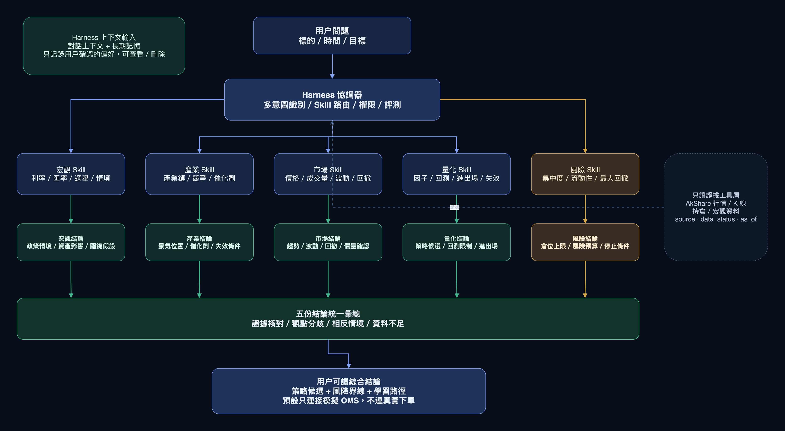

可編輯源文件：[`docs/evidence/diagrams/harness-financial-agents.drawio`](../evidence/diagrams/harness-financial-agents.drawio)。

### 多 Agent 多輪對話

右下角助手展示多輪提問與回應：不同分析角色並行整理持倉、宏觀、產業與量化視角，再由 Harness 彙總第二輪回撤問題。

`用戶問題 → Harness 路由多角色 → 證據核對／策略總結`

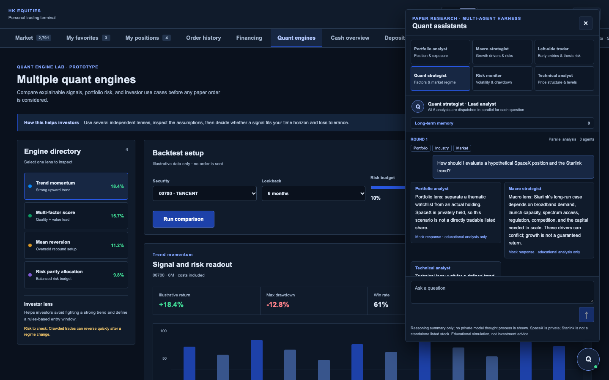

多 Agent 編排可組合不同分析角色，但不會自動保證分析正確；行情時效、來源透明、觀點評估和風險複核仍須納入產品設計。

### 產品競爭力判斷：好上手

不少競品已經提供完整的交易與研究體系；本產品不應靠功能清單取勝，而應降低用戶理解量化策略和宏觀判斷的門檻。通過分步提問、術語解釋、情景對比和策略覆盤，引導新手理解左側佈局、宏觀驅動配置與風險邊界，讓用戶邊研究邊學習、逐步形成自己的判斷。差異化目標是提升交易學習效率和決策質量，而不是替用戶保證收益或代替其作出決定。

### 案例：SpaceX／Starlink 與跨市場事件推演

1. **產業趨勢：** SpaceX 是未上市公司，Starlink 也不是獨立上市股票；助手先把衛星互聯網的用戶增長、發射能力、頻譜與資本開支列成觀察變量，再區分直接資訊與可交易的產業鏈映射，避免把品牌熱度直接當成可買入訊號。
2. **大跌與回撤：** 若發射失敗、監管限制、融資收緊或估值重估造成相關資產急跌，市場分析師先標記事件時間與波動擴張；助手同時列出近期高點、最新價、回撤百分比和觀察窗口，按「回撤 =（窗口高點 − 最新價）／窗口高點 × 100%」計算，讓用戶知道實際掉了多少，而不是只看方向。
3. **半導體與選舉情境融合：** SanDisk、Micron 與 Intel 可用於拆解記憶體週期、AI 伺服器需求、庫存修正、資本支出和產品執行力；面對近期美國選舉，宏觀 Skill 再把利率、財政政策、民調不確定性和歷史波動併入同一個事件窗口。產業分析師提出基本面假設，市場分析師核對成交量、趨勢和回撤百分比，量化分析師用事件前後窗口測試因子回撤，不把「逢選舉股市必跌」當成定律，也不把三家公司視為同一個風險因子。
4. **Tesla 顯著上行案例：** 當 Tesla 出現明顯上漲窗口時，助手先呈現累計漲幅、連續上漲天數、最大單日波動和成交量，再追蹤之後是否出現連跌、從近期高點回撤多少，以及事件前後的 5／20／60 個交易日表現。若市場把可驗證、可量產且符合監管要求的飛行車技術視為成長催化，產業 Skill 會拆解交付時間、成本、認證、現金流和估值；量化 Skill 同時保留「催化成功／延遲／未達預期」三種情境，避免把一段上漲直接歸因於單一消息或假設股價必然延續。
5. **多 Agent 輸出：** Harness 將上述觀點整理為「事件摘要 → 影響鏈 → 觀察數據 → 策略候選 → 風險界線 → 需要補充的問題」，讓用戶理解為什麼策略調整，而不是只收到一個買賣結論。

### DeepSeek 自部署方向

聊天助手可評估以 DeepSeek 開放權重模型自行部署：請求在自有推理環境處理，能夠減少對按 Token 計費的外部模型 API 的依賴，並在穩定調用量下提升單位推理成本的可控性，也便於管理資料留存邊界。

產品亦可持續跟進 DeepSeek 團隊的開源進展，把模型能力、推理效率與開放協作思路轉化為金融助手的角色 Skill 和評測方法；這裡只描述跟進方向，不把尚未核實的最新成果寫成已接入能力。自部署不等於零成本或必然更便宜；GPU 採購／租用、運維、人力、能耗、並發容量及模型評測都要納入總成本。應先用真實金融問答任務比較質量、延遲和總擁有成本，再決定自建或混合調用。

## 項目框架

### 前端與交互

React 頁面與組件組成工作台框架；市場頁採用「左側證券目錄／中央報價與 K 線／右側訂單操作區」的信息佈局。用戶的主要貢獻是原型圖和前端設計，由原型明確流程、層級和視覺驗收。

### 後端與數據

Go 代碼按 MVC 分層，數據庫訪問通過 repository 組織。當前實現邊界為行情 provider 接入和賬號認證；各業務頁面的完整服務邏輯仍需後續逐項交付。

### 部署與邊界

項目骨架採用 Docker Compose 組織 frontend、backend、mysql；phpMyAdmin 為可選管理工具。MVP 選用 AkShare 作為 HKEX 官方行情 feed 的替代來源；這是非官方公開數據，不代表 HKEX feed，也不等同於券商執行接口。

### 實施方法

先寫 Spec 和共享 API 合同，再按 TDD 執行 RED → GREEN → 集成／E2E → 獨立審查；多 Agent 按模塊邊界協作，由集成者核對接口、迴歸和視覺證據。

## 實現範圍

| 狀態 | 範圍 | 說明 |
| --- | --- | --- |
| 已實現 | 行情接入 | 後端行情適配器接入 AkShare 外部數據採集鏈路；當前屬於非官方數據，來源、更新時間和過期狀態必須按實顯示。 |
| 已實現 | 賬號登錄與密碼加密 | Go 認證服務使用 bcrypt 對密碼進行哈希校驗；數據庫保存哈希，不保存明文密碼。 |
| 已實現 | 代碼框架 | React 前端、Go MVC 分層、repository／integration 邊界及 Docker Compose 工程骨架。 |
| 原型圖 | 其餘工作台業務頁面 | 收藏、持倉、訂單、融資、資金、出入金、貨幣兌換和多 Agent 頁面表達位置、用途與目標交互；不代表業務服務已完整實現。 |

## 日 K 與行情來源

- 圖表使用 TradingView Lightweight Charts 呈現 API 回傳的 OHLCV；圖表庫本身不採集行情，也不提供港股歷史數據。
- AkShare 透過獨立採集服務接入，Compose 預設啟用 AkShare 歷史行情 provider；上游不可用時可依適配器規則回退，來源標籤不會冒充 AkShare。
- 為控制電腦與資料庫負載，採集名單最多三檔：`00700` 騰訊、`09988` 阿里巴巴、`01810` 小米；預設歷史窗口為最近六個日曆月。
- 近半年窗口同時適用日線與已配置的分鐘週期；分鐘資料遠多於日線，對上游請求、資料庫容量及重複回補造成較大負載，後續可按實際資源縮減分鐘週期。
- 報價仍按 15 分鐘間隔輪詢；成功回補後，歷史 K 線預設每日更新一次，避免每輪報價都重抓半年資料。
- AkShare 屬非官方公開數據源，不代表 HKEX 官方實時行情；行情狀態、來源與時間戳必須按 API 實際回傳顯示。

> **上游狀態說明：** AkShare 真實上游曾回傳 `RemoteDisconnected`；程式接入與失敗回退路徑已實作，但本次不能宣稱上游抓取成功。舊資料不會因這次配置變更而自動刪除。

## 行情來源選擇：以 AkShare 取代 HKEX 官方 Feed

- HKEX 官方市場數據須按授權、使用方式及用戶範圍付費，沒有可任意使用的免費港股行情 API；MVP 因成本與原型驗證需要，不接 OMD-C／OMD-D，改採 AkShare 公開行情適配器。
- AkShare 是非官方數據來源，可能延遲、缺漏或中斷；畫面必須保留來源、時間戳和 `stale`／`unofficial` 狀態，不得標記為 HKEX 官方實時行情。
- HKEX 官方 feed 與歷史資料市場仍是日後商業化的候選方案，不是目前系統已接入的服務；正式使用須先確認授權、用途與費用。
- 行情來源替代不涵蓋交易執行。真實下單仍須另接獲授權的券商／交易參與者 API，並透過獨立 execution adapter。

## 開發方式與項目架構

### AI-native 工程與 Codex

以 Codex 作為 AI-native 開發協作工具，讓 AI 參與需求拆解、程式碼導覽、Spec 草擬、測試先行實作、文件維護與變更審查；由人負責產品取捨、資料與安全邊界、合併決策及最終驗收。每項任務以可追溯的 Spec、測試結果和證據交付，不把模型輸出直接視為已驗證成果。

### Spec 與 TDD

先以業務語義和驗收標準寫 Spec，明確狀態、權限、數據可見性與失敗分支；實現行為變更時按 RED → 最小 GREEN → 定向測試 → 集成／E2E → 獨立審查推進。沒有執行的檢查明確記為待執行。

### 多 Agent 調度

按業務邊界派工，例如行情／K 線、訂單／持倉、資金／多語言和 UI 驗收；共享 OpenAPI、文件責任清單、任務證據台賬與 review gate，避免多個 Agent 同時改寫同一模塊而缺乏集成責任。

後端 MVC 按 Controller → Service → Model／Domain → Repository → Integration 分層；React 前端按頁面、功能組件、API 與狀態拆分。Codex 協助把原型和 Spec 轉成程式碼、測試與文件，並依照明確的檢查項提供審查線索；人類工程師負責核實行為、批准整合和承擔交付責任。用戶的強項是原型圖和前端設計：由用戶定義工作流、佈局和視覺驗收，工程實現再把原型轉成共享契約、測試和可運行頁面。

## 安全設計說明

### 密碼與多種算法

當前服務使用 bcrypt 做單向密碼哈希，數據庫不保存明文密碼。安全增強可按部署標準遷移到 Argon2id；應以算法前綴和版本管理單一哈希方案，不把多個哈希串接，也不把可逆加密當成密碼保存方式。

### HMAC 共享密鑰鑒權

AkShare 內部回調可使用共享密鑰做 HMAC 風格簽名、時間戳和最大年齡校驗，防止請求被竄改或重放。共享密鑰只放環境變量或密鑰管理服務；它不能替代 HTTPS、用戶登錄或券商交易授權。

### 前後端訪問鑒權與用戶數據隔離

用戶註冊或登錄後，Go 後端生成隨機 session token，透過 `ux_session` HttpOnly cookie 交由瀏覽器自動攜帶；MySQL 只保存 token 的 SHA-256 摘要，不保存原始 token。受保護的 `/api/v1/*` 請求由 Go 中間件校驗 session 是否存在、過期或已撤銷，以及用戶是否仍為 active；失敗返回 `401 unauthenticated`。

驗證成功後產生 session actor，service／repository 必須以該 actor 約束查詢，確保用戶不能靠修改前端參數讀取其他賬戶的收藏、訂單或持倉。這同時包含身份認證與資源授權；生產環境還應使用 HTTPS、`COOKIE_SECURE=true`，並補充 CSRF／Origin 校驗。

### SQL 注入防護

MySQL repository 使用 `database/sql` 佔位符和綁定參數，用戶輸入不拼接進 SQL。必要的動態表名或欄名只從固定 allow-list 選取；SQL、密碼、token、數據庫憑據和原始供應商載荷不返回前端或寫入日志。

> **基線與加固邊界：** bcrypt、opaque session、SHA-256 token digest、repository 參數化 SQL 和 AkShare 回調密鑰是現有基線；Argon2id 遷移、密鑰輪換、CSRF／Origin 複核、限流、依賴掃描和外部安全審查仍需按部署環境完成。

## 聲明

Development prototype · 非投資建議。此項目不提供官方 HKEX 實時行情、真實券商接入、真實資金轉移或真實訂單執行。
