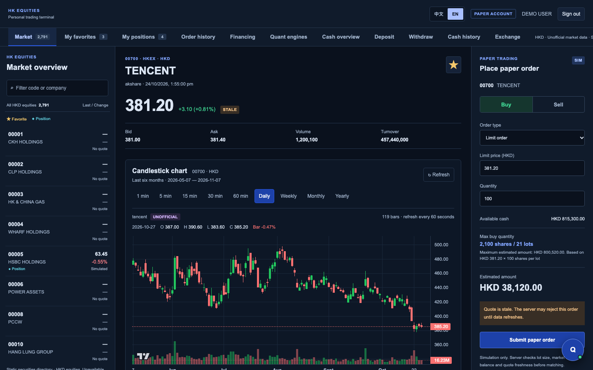
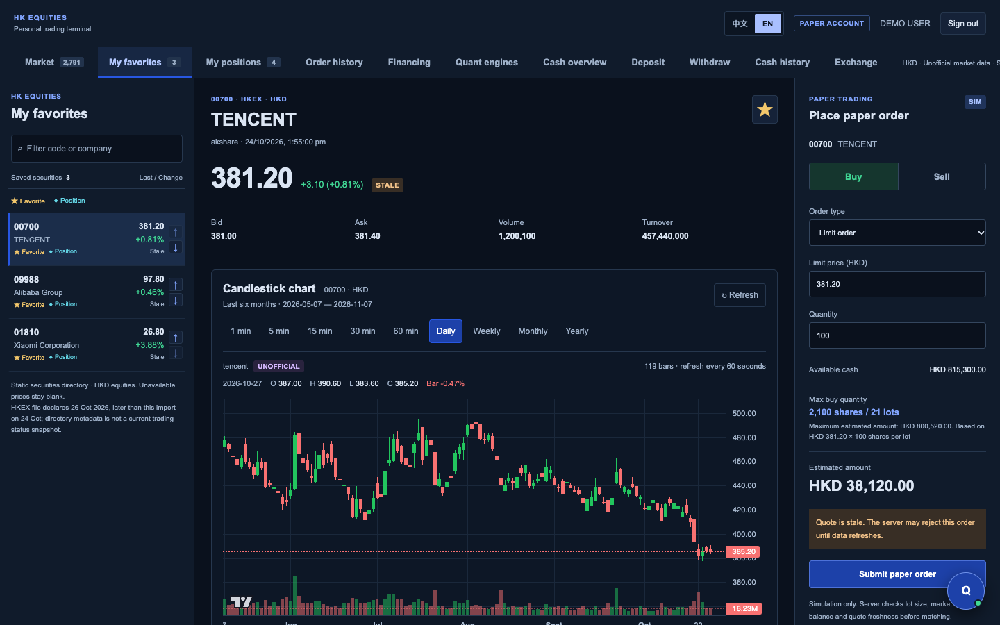
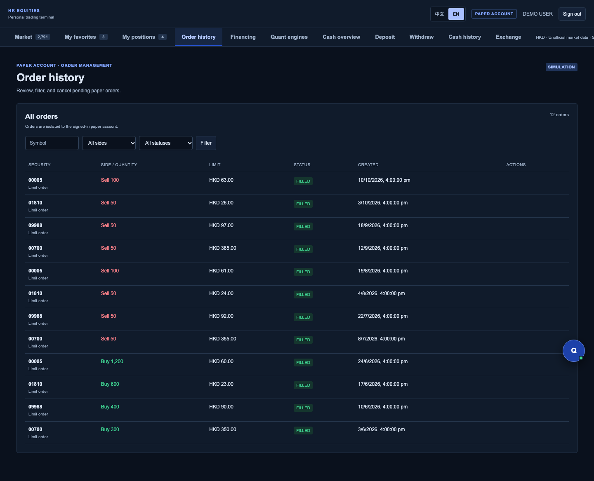
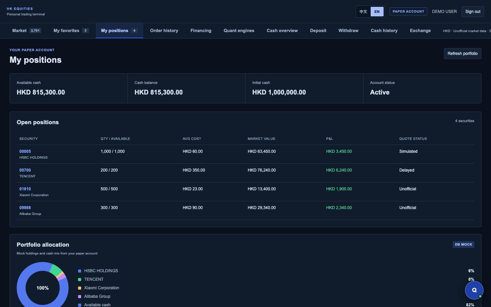
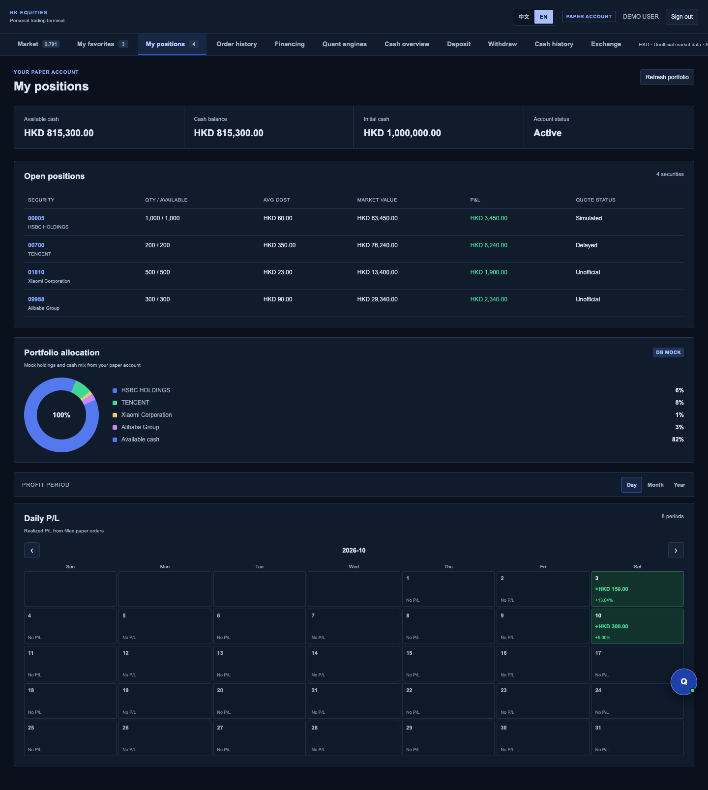
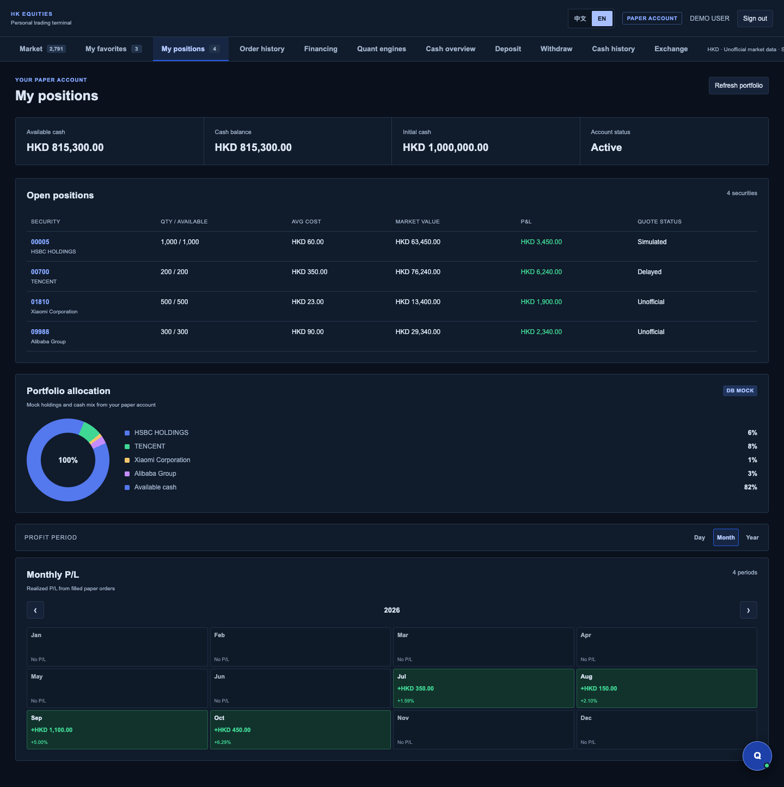
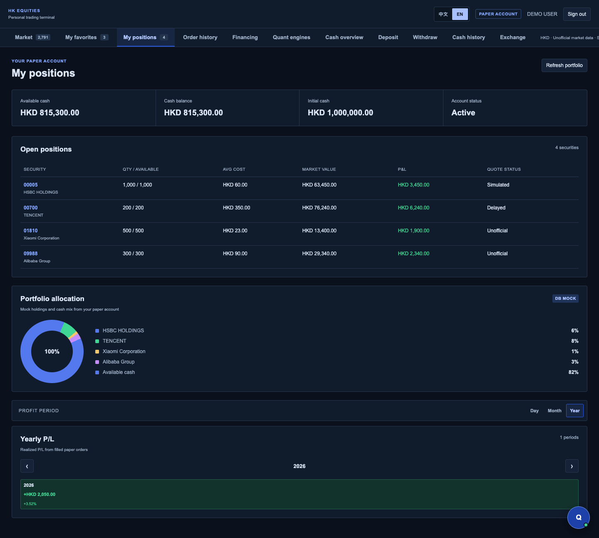
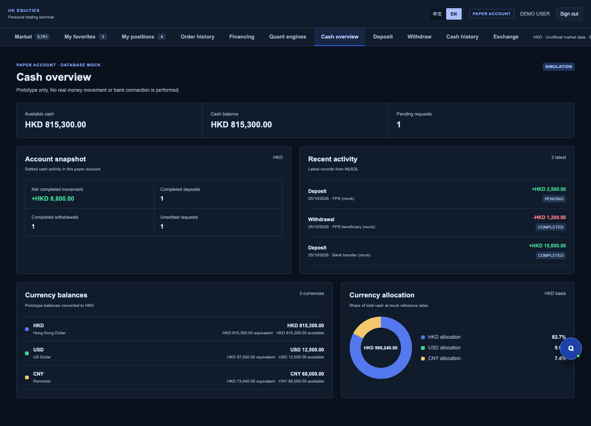
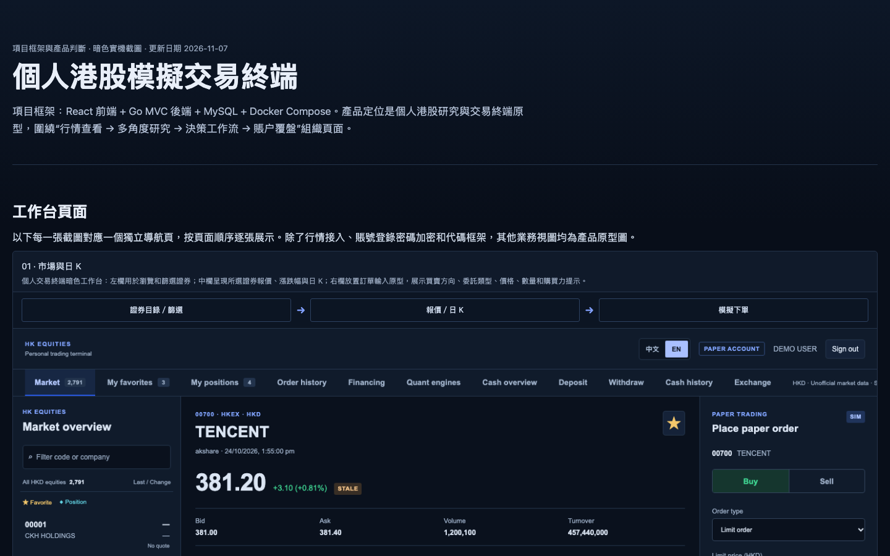
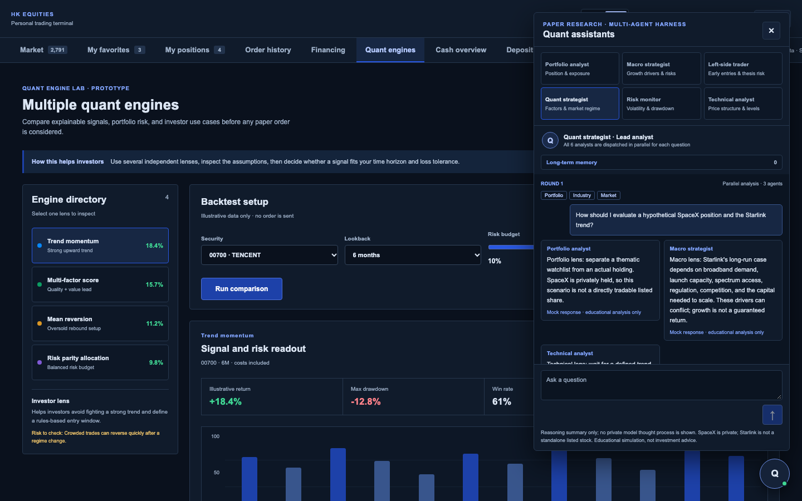

# Personal Trading Terminal — Product Walkthrough

## Product goal

The terminal is designed as a focused personal workspace for Hong Kong equities. The first screen after the overview is the workbench, followed by the AI assistant, so the story stays centered on the delivered product flow.

## Market workspace

The page follows a three-part layout:

1. A left directory for securities and navigation.
2. A central quote and candlestick analysis area.
3. A contextual action area for simulated trading.

The candlestick surface uses the same dark palette as the rest of the workspace, avoiding a visually disconnected white chart. Historical controls cover minute, day, week, month, and year views where source data is available.

## Favorites

Favorites are a curated personal list, not a duplicate of the full market directory. The demonstration list contains `00700`, `09988`, and `01810`, with controls for changing their order.

## Orders

Orders are simulated. The product distinguishes pending, filled, cancelled, and rejected outcomes, and should explain failures such as invalid quantity, insufficient balance, missing prices, stale market data, or a closed market.

## Positions

Performance is separated into distinct views so the user can compare short- and longer-term movement without changing the underlying portfolio context.

## Cash workspace

The supporting states show the planned account workflow:

- [Deposit](../../evidence/screenshots/personal-terminal/dark/deposit.png)
- [Withdrawal](../../evidence/screenshots/personal-terminal/dark/withdraw.png)
- [Currency exchange](../../evidence/screenshots/personal-terminal/dark/exchange.png)
- [Financing](../../evidence/screenshots/personal-terminal/dark/financing.png)
- [Cash history](../../evidence/screenshots/personal-terminal/dark/cash-history.png)

These are prototype and simulation surfaces only; no real banking or brokerage transfer is performed.

## Notes and assistant

The assistant sits below the workbench in the narrative because it is an aid to the user's analysis. It may summarize market context and explain interface states, but it must not silently submit orders or treat model output as verified financial advice.

## Current boundary

The repository provides a working application skeleton and selected integrated flows. Public market data is an unofficial development source and may be delayed or unavailable. Real-time licensed data and real order execution require separate provider contracts, authorization, compliance review, and dedicated adapters.
